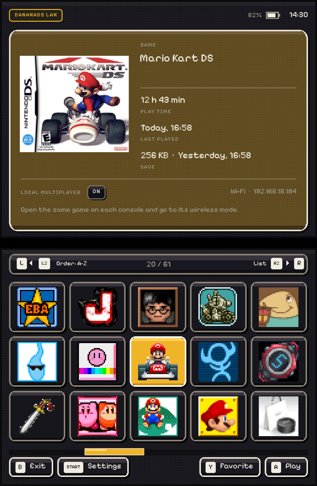
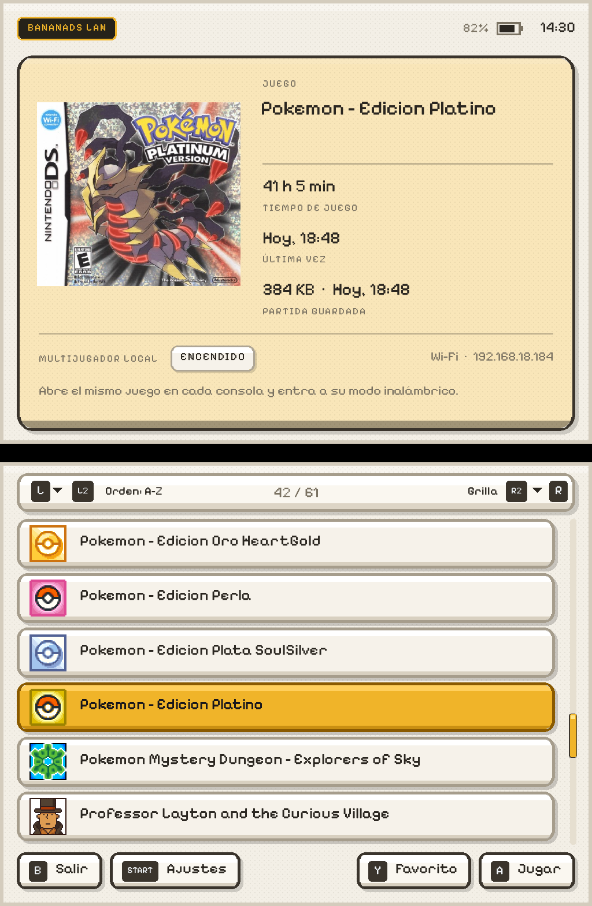

# BananaDS LAN

  <b>Local multiplayer for handheld games on BananaOS — same network, play together.</b>

  <a href="#at-a-glance">At a glance</a> ·
  <a href="#get-it-on-your-card">Get it on your card</a> ·
  <a href="#remove-it">Remove it</a> ·
  <a href="#tips">Tips</a>

<table>
  <tr>
    <td align="center" width="50%">
       
      <b>Grid</b>
    </td>
    <td align="center" width="50%">
       
      <b>List</b>
    </td>
  </tr>
</table>

## At a glance

- 📡 **Linked play** on your home network — local multiplayer is on by default for compatible games.
- 📚 **In-app library** with play time, last played, saves, and the console IP for sessions.
- 🌐 **English or Spanish** — follows the handheld language.
- 💾 **Saves** on the card at `/data/saves/nds` (shared with the system save folder).
- 🔄 **Updates** from inside the app when a release is available.

## Get it on your card

**Option A — one installer file**

1. Download **Install-BananaDS-LAN.sh** from the release.
2. Copy it into **store/tiles** on the shared **banana** folder (do not replace the whole **store** folder).
3. Reboot once, open **Apps**, and run the installer tile.

**Option B — full zip**

1. Download the release zip and extract it.
2. Copy **bananads-lan** into **store/apps** and **BananaDS LAN.sh** into **store/tiles** (do not replace the whole **store** folder).
3. Reboot once, then open **Apps**.

After either option, leave **Apps** and open **Apps** again so the list refreshes (temporary BananaOS limitation).

More steps (file sharing, copying from a computer, etc.) are in `INSTALL.txt`.

## Remove it

1. Open the app, then press **START** to open **Settings**.
2. Press **Y** for **Uninstall**, then **A** to confirm.

The app removes itself and its tile; games use the system emulator again.

## Tips

- Play on a strong network; a weak link can stutter.
- Open the **same title** on each console and enter its multiplayer mode from the game.
- For a more stable link between consoles, install [Direct Link](https://github.com/pixeladodev/bananaos-direct-link).

## Built with

Open source (GPL v3). On-screen UI in C; packaging scripts match the Store layout. See `SOURCE.md`, `build/package.sh`, and `build/selftest.sh`.

## Credits

**Pixelado Dev** — built with AI-assisted development, reviewed on real hardware when possible. Provided as-is; see `LICENSE`.